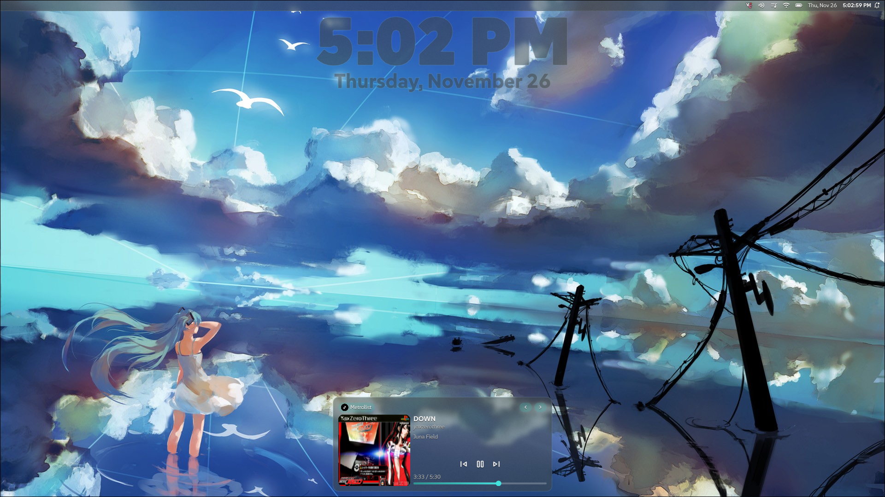
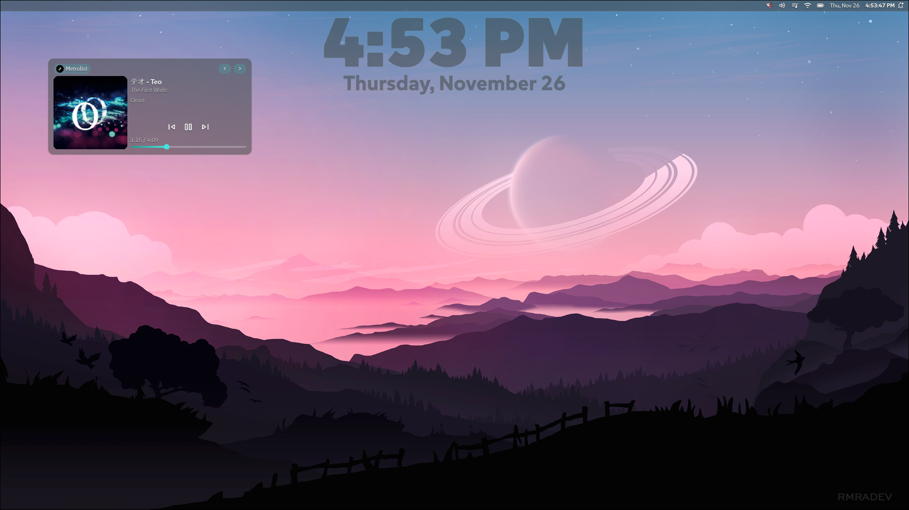
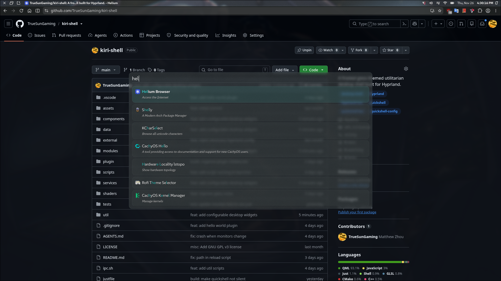

# Kiri Shell

*霧 (pronounced きり, kee-ree) — mist/fog*

A frosted glass-themed utilitarian desktop shell built for Hyprland.

<p align="center">
    Desktop widgets + menu/status bar:
    <br>
    
    
</p>

<p align="center">
    App launcher with fuzzy finder:
    <br>
    
</p>


## Dependencies
* Hyprland with Lua config
* Qt 6.12
* Qt Shader Tools
* Quickshell 0.3.2
* CMake 3.16
* Just

```sh
sudo pacman -S hyprland qt6-base qt6-declarative qt6-svg qt6-wayland qt6-shadertools quickshell cmake just
```

## Manual Installation

Clone the repo, and add [reload.sh](/reload.sh) to Hyprland's autostart (will automatically build the shell on first launch or when updated):

```lua
-- ~/.config/hypr/hyprland.lua
hl.on("hyprland.start", function()
    hl.exec_cmd("/path/to/kiri/reload.sh")
end)
```

For the launcher, add a bind to the IPC call:

```lua
hl.bind("SUPER + R", hl.dsp.exec_cmd("/path/to/kiri/ipc.sh launcher open"))
```

## Configuration
Kiri Shell can be configured by editing `$CONFIG_DIR/kiri-shell/config.json`. It is generated with default values when the shell is running if it is missing.

The config folder can be opened by running `>Settings Folder` in the app launcher.